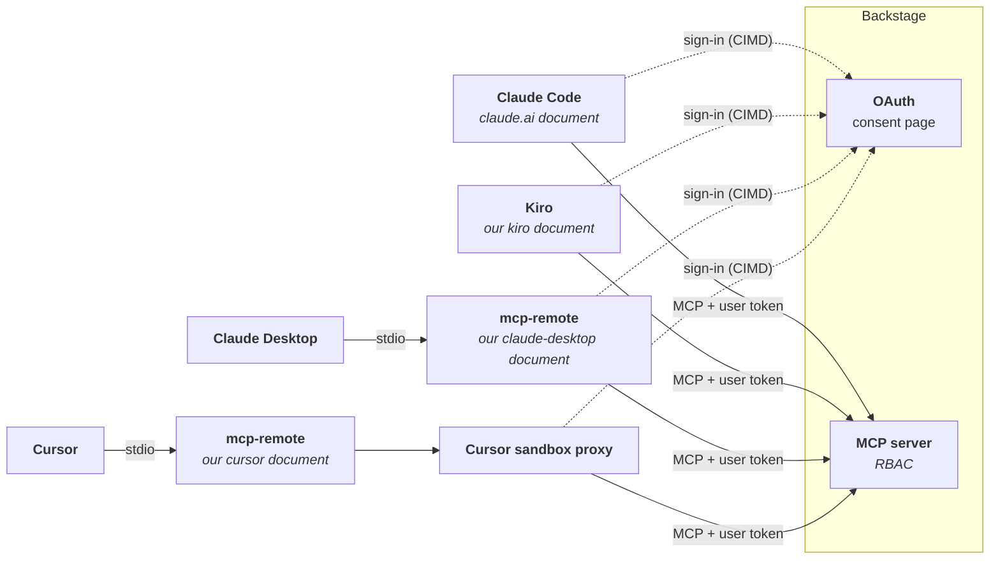

# 🔐 One MCP Server, Four AI Tools, One OAuth Setup

_Per-user OAuth for a VPN-only Backstage MCP server across Claude Code, Claude Desktop, Cursor and Kiro, when most of them don't speak CIMD yet_

## 🎯 What I was trying to do

Our Developer Portal ([Backstage](https://backstage.io)) now runs an MCP server, so engineers can ask their AI tools about our software catalog: who owns a service, what breaks if it goes down, which APIs it exposes. A catalog nobody can query from where they work is a catalog nobody reads, so the server had to show up in the tools people already use: **Claude Code, Claude Desktop, Cursor and Kiro**.

Two constraints shaped everything:

- **Every engineer signs in as themselves.** No shared token. With per-user OAuth, the catalog's permissions apply to each person and the audit log names who asked what. There's also no secret to store, rotate or leak.
- **VPN only.** The portal is only reachable on internal hostnames, with a certificate from the company's internal CA.

_Checked in October 2026. Client support for the MCP authorization spec is moving fast, so several details below will age._

---

## 🪪 Signing in needs a user *and* an app

When an AI tool connects, the portal sends the user to a consent page: "*X* wants to access your account. Allow?" That page needs two answers:

- **Who is the user?** They log in on the consent page. This part is never the problem.
- **Which app is asking?** The *X* on the page. In OAuth that's the **client ID**, and the question is how the portal learns it for an app it has never seen.

The [MCP authorization spec](https://modelcontextprotocol.io/specification/latest/basic/authorization) gives an app two ways to introduce itself:

- **Dynamic Client Registration (DCR): register first.** The app calls an API saying "register me", the server stores it and hands back an ID. Anyone can register, every install leaves a stored record, and Backstage marks its DCR support as deprecated.
- **Client ID Metadata Documents ([CIMD](https://datatracker.ietf.org/doc/draft-ietf-oauth-client-id-metadata-document/)): bring a name tag.** The client ID *is* an HTTPS URL, and at that URL sits a small JSON document with the app's name and where to send the user after login. The server fetches it, checks it against an allowlist and shows the consent page. Nothing is registered or stored.

The [2025-11-25 spec revision](https://modelcontextprotocol.io/specification/2025-11-25/basic/authorization#client-registration-approaches) says clients and servers SHOULD support CIMD, and keeps DCR as a MAY "for backwards compatibility". Backstage [supports CIMD](https://backstage.io/docs/ai/mcp-actions), so the plan was simple: DCR off, allowlist the apps' name tags, and every tool signs in through the portal's consent page.

---

## 🧱 The catch: only one of the four had its own name tag

- **Claude Code** has CIMD built in, with its own document at `https://claude.ai/oauth/claude-code-client-metadata`. It worked on the first try.
- **Kiro** can do the OAuth flow itself, but brings no name tag of its own.
- **Cursor** can't do CIMD at all, only DCR or a pre-registered client ID and secret.
- **Claude Desktop** can't even reach the server: its remote servers go through Anthropic's cloud connectors, which can't see a VPN-only host. Its local config only starts command-based servers.

The wider picture, for anyone making the same call:

| Client | CIMD sign-in | Notes |
|---|---|---|
| Claude Code | ✅ | Worked on the first try |
| VS Code (Copilot) | ✅ | Built in |
| Cursor | ❌ | Only DCR or a pre-registered client ID/secret; open [feature request](https://forum.cursor.com/t/mcp-oauth-cimd-support-plans-and-timelines/148096) |
| Kiro | ⚠️ | No native CIMD ([kirodotdev/Kiro#11076](https://github.com/kirodotdev/Kiro/issues/11076)), but it can be pointed at a hosted document with [`oauth.clientMetadataUrl`](https://kiro.dev/docs/mcp/configuration/) |
| Claude Desktop | ⚠️ | Cloud connectors can't reach a VPN-only host; locally, command-based servers only |
| GitHub Copilot CLI | ⚠️ | CIMD, with a callback-port bug ([#1305](https://github.com/github/copilot-cli/issues/1305), [#4793](https://github.com/github/copilot-cli/issues/4793)) |
| OpenAI Codex CLI | ✅ | Per its [docs](https://developers.openai.com/codex/mcp) (not tried) |

Turning DCR back on would have helped Cursor, but it's deprecated and lets every client register itself. Exposing the portal to the internet so cloud connectors could reach it was out of the question.

---

## 💡 The fix, in two parts

Two different gaps, two different fixes. Kiro can do the login but has no name tag, so **we give it one**, and since we're handing them out, every tool gets its own. Cursor and Claude Desktop can't do the login at all, so **a helper does it for them**.

### Part 1: we host the name tags ourselves

A tiny Backstage backend plugin serves one client document per tool at `GET /api/mcp-client/<tool>/client-metadata.json`, for `kiro`, `claude-desktop` and `cursor`. Cursor's looks like this:

```json
{
  "client_id": "https://<portal-host>/api/mcp-client/cursor/client-metadata.json",
  "client_name": "MCP bridge (Cursor)",
  "redirect_uris": ["http://localhost/oauth/callback", "http://127.0.0.1/oauth/callback"],
  "grant_types": ["authorization_code", "refresh_token"],
  "token_endpoint_auth_method": "none",
  "scope": "openid offline_access"
}
```

Any program that can do OAuth but has no name tag can use one of these URLs as its client ID. Kiro does exactly that, pointing `oauth.clientMetadataUrl` at the `kiro` document.

> **Why one per tool and not one shared document?** With a single "MCP bridge" document, Kiro, Claude Desktop and Cursor would all be the same app to the portal. The user would still be known, but the audit log couldn't say which tool asked, the consent page would look the same for every tool, and there'd be no way to revoke one tool while keeping the others. Separate documents cost one route parameter and one allowlist entry per tool.

Three details made it work:

- **The client ID must equal the document's own URL.** So each document is built from the environment's external URL at startup, and local, staging and production each serve correct documents.
- **Each document is allowlisted by its exact URL.** In the Backstage version we run, fetching a client document from a private IP was rejected as SSRF protection, and our portal *is* a private IP. An exact allowlist entry, without wildcards, got past that check.
- **Localhost callbacks match on host and path, not port.** Any local callback port works, which matters for clients that pick a random one.

### Part 2: a helper that does the login: `mcp-remote`

Claude Desktop and Cursor can't do the OAuth flow, but they can run a local program as an MCP server. So instead of pointing them at the portal, we point them at [`mcp-remote`](https://www.npmjs.com/package/mcp-remote):

```json
{
  "mcpServers": {
    "backstage": {
      "command": "npx",
      "args": [
        "-y", "--node-options=--use-system-ca",
        "mcp-remote@0.14.3",
        "https://<portal-host>/api/mcp-actions/v1",
        "--client-metadata-url", "https://<portal-host>/api/mcp-client/cursor/client-metadata.json",
        "--enable-proxy"
      ]
    }
  }
}
```

That's Cursor's config. Claude Desktop's is the same command with its own `claude-desktop` document. There's no proxy server to deploy. When the AI tool starts, it runs that command, and `mcp-remote` lives as a child process on the user's own laptop until the tool quits. Every user gets their own copy.

```
Cursor  ──stdin/stdout──►  mcp-remote  ──HTTPS + user's token──►  portal MCP server
(no login code)            (same laptop; does the
                            OAuth with Cursor's name tag)
```

- **Toward the AI tool,** it's a plain local MCP server that needs no login.
- **Toward the portal,** it's an OAuth client using the name tag it was given. The first time, it opens the consent page in the browser, catches the callback on localhost and gets the user's tokens. After that it stores and refreshes them itself.
- **In between,** it forwards every MCP message with the user's token attached.

The login didn't go away, it moved. **`mcp-remote` is now the OAuth client**, and the AI tool never sees a token. The token is still the user's own, so the portal still sees "Alice asked this" and applies Alice's permissions. Only the program holding the token changed.

The trade-off is the one the spec calls out for localhost redirects: these are public clients with localhost callbacks, so any local process can present the Cursor document, and the user will see "MCP bridge (Cursor)" on the consent page. The same is true of Claude Code's document on claude.ai. So the per-tool documents are labels, not proof: they keep the audit log and the consent page honest, but the security boundary is still the user's own sign-in and the VPN. That's acceptable here because the consent page is a deliberate click by the person whose token it becomes.

### Who does the login

| Tool | Who does the OAuth | Whose name tag |
|---|---|---|
| Claude Code | Claude Code | Anthropic's |
| Kiro | Kiro | ours: `kiro` |
| Claude Desktop | `mcp-remote` | ours: `claude-desktop` |
| Cursor | `mcp-remote` | ours: `cursor` |

Claude Desktop worked through the helper right away. Cursor did not.

---

## ⛰️ Cursor's three walls

The design above was right. What broke was the environment Cursor launches `mcp-remote` in, and it broke three times. The config shown earlier is the end result. Getting there, Cursor said `MCP 'backstage' is not connected`, and kept saying exactly that through three different problems, each one hiding behind the previous.

### Wall 1: the certificate

Run by hand, the proxy failed with:

```
SELF_SIGNED_CERT_IN_CHAIN
```

Browsers trust our internal CA through the macOS keychain, but Node.js ships its own CA list and ignores the keychain. Node 22.15+ can use the OS trust store with [`--use-system-ca`](https://nodejs.org/api/cli.html#--use-system-ca).

### Wall 2: the vanishing environment

The obvious way to pass that flag is the `env` block in Cursor's MCP config:

```json
"env": { "NODE_OPTIONS": "--use-system-ca" }
```

It changed nothing. With `--debug`, the proxy's log showed every request failing with `fetch failed`: Cursor doesn't pass `NODE_OPTIONS` through to the process. Moving the flag into the arguments fixed that layer, because `npx` hands it to Node itself:

```sh
npx -y --node-options=--use-system-ca mcp-remote@0.14.3 …
```

### Wall 3: the sandbox

Still "not connected". By now the command was provably correct: it worked in a terminal, and it worked when launched the way a generic MCP client launches it. So the difference had to be in *how Cursor runs it*.

Guessing wasn't getting anywhere, so I replaced the proxy with a 20-line fake MCP server. It printed its environment and the result of a test request to stderr, then exited. Cursor shows a failing server's stderr in its error message, so the answer came back through Cursor's own UI:

```
DIAG systemCA=true | fetch FAILED getaddrinfo ENOTFOUND <portal-host>
ENV[ALL_PROXY=http://127.0.0.1:54442 CURSOR_SANDBOX=seatbelt …]
```

**In the Cursor version I tested, MCP servers ran in a macOS sandbox (seatbelt)**, even with its sandbox setting turned off. Inside it there's no direct network and no DNS. The only way out is a local proxy that Cursor advertises in `ALL_PROXY` / `HTTPS_PROXY`, and that proxy only allows Cursor's default domains plus whatever is in [`~/.cursor/sandbox.json`](https://cursor.com/docs/reference/sandbox). Our proxy talked to the network directly (Node's `fetch` ignores proxy variables), so it couldn't even resolve the hostname.

The fix has two parts. Use Cursor's proxy, which `mcp-remote --enable-proxy` does by honouring `HTTPS_PROXY`. And allow our hosts:

```json
// ~/.cursor/sandbox.json
{ "networkPolicy": { "allow": ["*.<internal-domain>"] } }
```

Cursor's proxy runs outside the sandbox, so it resolves names through the system DNS, internal VPN zone included. TLS is tunnelled through it unchanged, so `--use-system-ca` is still needed.

| Layer | Symptom | Cause | Fix |
|---|---|---|---|
| TLS | `SELF_SIGNED_CERT_IN_CHAIN` | Node ignores the macOS keychain | `--use-system-ca` |
| Process environment | `fetch failed` despite the `env` setting | Cursor drops `NODE_OPTIONS` | flag as an `npx` argument |
| Network sandbox | `getaddrinfo ENOTFOUND` | seatbelt, proxy-only network | `--enable-proxy` + `sandbox.json` |

Three layers, one error message.

---

## 🗺️ The final picture



Dashed lines are the one-time sign-in that issues a token to whoever holds the OAuth client role: the AI tool itself, or `mcp-remote` on its behalf. Solid lines are the MCP traffic, which carries that user's token on every request.

One consent page that names the tool, one sign-in per engineer per tool, permissions per person, and no shared secrets. All four tools are verified against staging.

---

## 📝 What I'll remember

**Standards arrive unevenly.** CIMD is the spec's recommended path, yet only some clients support it. Check client support before picking the auth design, and plan a fallback.

**You can be the client.** If a client can't identify itself, a document you host for it plus a small local proxy lets it join the standard flow, without weakening the server: no DCR, no shared tokens.

**"Not connected" is not a diagnosis.** Get the real error out of the process: run the command by hand, turn on debug logs, or make the host show you stderr.

**A diagnostic stand-in beats guessing.** A fake server reporting its own environment answered in one run what theories couldn't.

**"Works for me" needs the same launch conditions.** Same command, same machine, different parent process: environment, sandbox and network can all differ.

**Corporate networks multiply all of this.** Internal CAs, internal DNS and VPN-only hosts break assumptions that AI tools make. Expect a trust fix and a network fix for every new client.

---

## 📚 Sources

- MCP authorization spec: [Client ID Metadata Documents and DCR](https://modelcontextprotocol.io/specification/latest/basic/authorization)
- [IETF draft: OAuth Client ID Metadata Document](https://datatracker.ietf.org/doc/draft-ietf-oauth-client-id-metadata-document/)
- [Backstage MCP actions backend](https://backstage.io/docs/ai/mcp-actions)
- Cursor: [CIMD support feature request](https://forum.cursor.com/t/mcp-oauth-cimd-support-plans-and-timelines/148096), [sandbox.json reference](https://cursor.com/docs/reference/sandbox), [MCP docs](https://cursor.com/docs/mcp)
- Kiro: [MCP configuration](https://kiro.dev/docs/mcp/configuration/), [issue #11076: CIMD-only servers fail](https://github.com/kirodotdev/Kiro/issues/11076)
- GitHub Copilot CLI: [#1305 CIMD support](https://github.com/github/copilot-cli/issues/1305), [#4793 callback port](https://github.com/github/copilot-cli/issues/4793)
- [OpenAI Codex: MCP (CIMD)](https://developers.openai.com/codex/mcp)
- [Testing CIMD support across Anthropic's Claude products](https://leduccc.medium.com/testing-cimd-support-across-anthropics-claude-products-585366dbe089)
- [mcp-remote](https://www.npmjs.com/package/mcp-remote) (`--client-metadata-url`, `--enable-proxy`, `--debug`)
- [Node.js `--use-system-ca`](https://nodejs.org/api/cli.html#--use-system-ca)
